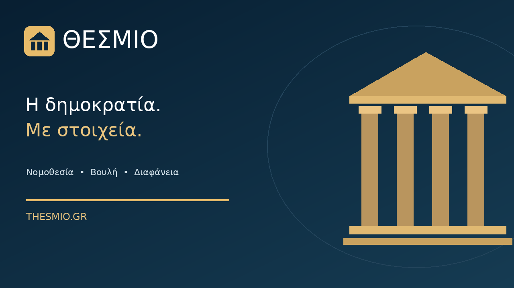
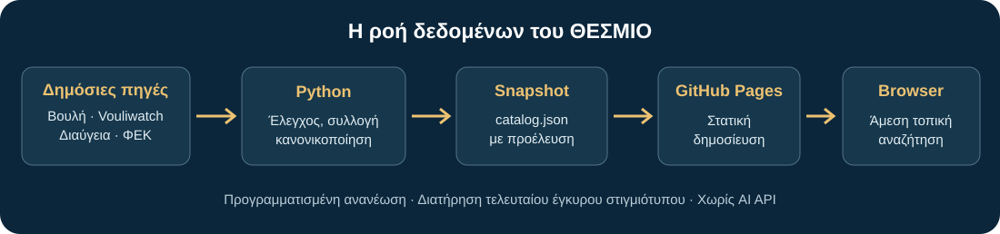

<div align="center">
  

  # ΘΕΣΜΙΟ

  **Η δημοκρατία. Με στοιχεία.**

  Ανοιχτή ελληνική πλατφόρμα για νομοθεσία, κοινοβουλευτική δραστηριότητα και δημόσιες αποφάσεις.

  [**Ζωντανή εφαρμογή**](https://donacgreece.github.io/thesmio/) · [**Αναφορά προβλήματος**](https://github.com/Donacgreece/thesmio/issues) · [**Πηγές δεδομένων**](#πηγές-και-προέλευση)

  
  
  
  
</div>

---

## Η πλατφόρμα

Το ΘΕΣΜΙΟ συγκεντρώνει πληροφορίες από δημόσιες πηγές σε ένα ενιαίο περιβάλλον. Στόχος είναι η ευκολότερη αναζήτηση, η τεκμηριωμένη ενημέρωση και η διαφάνεια ως προς την προέλευση κάθε εγγραφής. Η εφαρμογή είναι ανεξάρτητη πρωτοβουλία και **δεν αποτελεί επίσημη κρατική υπηρεσία**.

Η τρέχουσα έκδοση διαθέτει:

- **Νομοθεσία:** κατάλογο νόμων, φίλτρα, ταξινόμηση, σύνδεση με πηγή και προσωπικά αγαπημένα.
- **Βουλή:** βουλευτές, κόμματα, ψηφοφορίες και κοινοβουλευτικό έλεγχο, στο μέτρο που τα διαθέσιμα API παρέχουν τις εγγραφές.
- **Διαύγεια:** πρόσφατες δημοσιευμένες διοικητικές πράξεις με ΑΔΑ και σύνδεση στην πρωτογενή πράξη.
- **Ενιαία αναζήτηση:** άμεση αναζήτηση στα διαθέσιμα, ήδη συγχρονισμένα δεδομένα.
- **Διαφάνεια πηγών:** ημερομηνία τελευταίου επιτυχημένου συγχρονισμού και σφάλματα ανά συλλογή.
- **Responsive UI:** κινητό, tablet, desktop και dark mode.

> **Όρια κάλυψης:** η εμφάνιση μιας εγγραφής δεν σημαίνει ότι το ΘΕΣΜΙΟ διαθέτει πλήρες ιστορικό ή το ισχύον κωδικοποιημένο κείμενο του νόμου. Οι τρέχουσες συλλογές έχουν διαφορετικά όρια και χρονική κάλυψη. Ελέγχετε πάντοτε το ΦΕΚ και την πρωτογενή επίσημη πηγή για νομική χρήση.

## Πώς λειτουργεί



Τα API **δεν καλούνται σε κάθε αναζήτηση επισκέπτη**. Το GitHub Actions εκτελεί συλλογή δεδομένων τέσσερις φορές την ημέρα, κανονικοποιεί τις απαντήσεις και ενημερώνει το `public/data/catalog.json`. Το GitHub Pages σερβίρει το στατικό snapshot. Η αναζήτηση γίνεται γρήγορα στον browser, ακόμη κι αν μια δημόσια υπηρεσία είναι προσωρινά εκτός σύνδεσης.

**Γιατί έτσι;** Τα δημόσια API μπορούν να έχουν ρυθμοόρια, CORS restrictions ή να απορρίπτουν αιτήματα από συγκεκριμένα δίκτυα. Η ανεξαρτησία της αναζήτησης από αυτά προστατεύει την εμπειρία του επισκέπτη και τη σταθερότητα του site.

### Συλλογή νόμων

Η πρώτη επιλογή είναι το **επίσημο Open Data API της Βουλής**. Αν απορρίψει τις κλήσεις (έχει παρατηρηθεί HTTP 403 από GitHub Actions), η εφαρμογή δοκιμάζει δημόσιο **εναλλακτικό κατάλογο κειμένων ΦΕΚ** από το [kafidas/just-text](https://github.com/kafidas/just-text), με σαφή σήμανση προέλευσης. Η εναλλακτική πηγή **δεν εγγυάται πρόσφατα δεδομένα ούτε κωδικοποίηση των διατάξεων**. Αν δεν υπάρχουν έγκυρες εγγραφές στο just-text, ο συγχρονισμός δοκιμάζει ευρετήριο δημοσιευμένων τευχών ΦΕΚ Α΄ από το [lighteternal/legalize-gr](https://github.com/lighteternal/legalize-gr). Τα τεύχη εμφανίζονται ως **ΦΕΚ** και όχι ως νόμοι: ένα τεύχος μπορεί να περιέχει περισσότερες πράξεις. Το ΘΕΣΜΙΟ δεν επινοεί εγγραφές όταν καμία πηγή δεν δίνει έγκυρη απάντηση.

## Πηγές και προέλευση

| Συλλογή | Πηγή | Σημειώσεις |
| --- | --- | --- |
| Νόμοι | [Βουλή των Ελλήνων](https://www.hellenicparliament.gr/opendata/) | Επίσημο API. Μπορεί να επιστρέφει HTTP 403. |
| Εναλλακτικά κείμενα νόμων | [kafidas/just-text](https://github.com/kafidas/just-text) | Διαθέσιμο αρχείο κειμένων από ΦΕΚ, μη κωδικοποιημένο. Αναφορά: Lampros Kafidas, DOI [10.7910/DVN/F1CNFC](https://doi.org/10.7910/DVN/F1CNFC). |
| Εναλλακτικό ευρετήριο ΦΕΚ Α΄ | [lighteternal/legalize-gr](https://github.com/lighteternal/legalize-gr) | Δημόσιο αρχείο ΦΕΚ Α΄ σε Markdown. Οι αριθμοί τευχών δεν είναι αριθμοί νόμων. |
| Κοινοβουλευτικά στοιχεία | [Vouliwatch API](https://api.vouliwatch.gr/v1) | Επιμελημένη βάση. Ισχύουν οι όροι του παρόχου και η άδεια CC BY-NC 4.0. |
| Διαύγεια | [Επίσημο Open Data API](https://diavgeia.gov.gr/api/help) | Πρόσφατα αποτελέσματα, όχι πλήρης ιστορική αντιγραφή. |
| Διαφάνεια Βουλής | [Open Data](https://diafaneia.hellenicparliament.gr/OpenData) | Ξεχωριστή υπηρεσία, πιθανό HTTP 403. |

Οι πηγές και τα χρονικά όρια πρέπει να αξιολογούνται ξεχωριστά. Η άδεια του **κώδικα του ΘΕΣΜΙΟ** δεν αλλάζει τα δικαιώματα τρίτων παρόχων επί των δεδομένων τους.

## Τεχνολογίες

| Επίπεδο | Εργαλείο |
| --- | --- |
| Frontend | React, TypeScript, Vite |
| Styling / icons | CSS, Lucide |
| Data pipeline | Python 3, JSON snapshots |
| Scheduling | GitHub Actions, 4 εκτελέσεις ανά ημέρα |
| Deployment | GitHub Pages |
| AI | Δεν χρησιμοποιείται AI API |

## Τοπική εκτέλεση

Απαιτούνται **Node.js 22+**, **npm**, **Python 3** και **Git**.

```bash
git clone https://github.com/Donacgreece/thesmio.git
cd thesmio
npm install
npm run dev
```

Δοκιμές και παραγωγικό build:

```bash
python -m unittest discover -s scripts -p 'test_*.py'
npm run check
npm run build
```

Ο προγραμματισμένος συγχρονισμός εκτελείται στο GitHub Actions. Για χειροκίνητη εκτέλεση:

```bash
python scripts/sync_data.py
```

**Προσοχή:** αυτή η εντολή κάνει πραγματικές κλήσεις στις εξωτερικές υπηρεσίες και αντικαθιστά το snapshot μόνο για τις συλλογές που ενημερώθηκαν επιτυχώς.

### Δημοσίευση από Windows

Περιλαμβάνονται `INSTALL-THESMIO-COMMAND.cmd` και `push-thesmio.ps1`. Μετά την εγκατάσταση της εντολής μπορείτε να πληκτρολογείτε `thesmio` σε νέο PowerShell, ανεξάρτητα από τον τρέχοντα φάκελο. Πριν από το push εκτελούνται έλεγχος TypeScript και παραγωγικό build. Για έλεγχο χωρίς push:

```powershell
powershell -NoProfile -ExecutionPolicy Bypass -File .\push-thesmio.ps1 -SkipPush
```

## Αντιμετώπιση προβλημάτων

**Δεν εμφανίζονται νόμοι:** ελέγξτε `public/data/catalog.json` → `sources.laws.error` και στη συνέχεια [Actions](https://github.com/Donacgreece/thesmio/actions) → *Collect open datasets*. HTTP 403 σημαίνει ότι η υπηρεσία απορρίπτει το αίτημα. Δεν λύνεται με αλλαγή CSS ή parser.

**Λείπουν εγγραφές:** κάθε API επιστρέφει διαφορετική χρονική κάλυψη. Οι μετρητές απεικονίζουν τις διαθέσιμες εγγραφές της συλλογής, όχι επίσημα συγκεντρωτικά στατιστικά για ολόκληρη την Ελλάδα.

**Το GitHub Pages δείχνει παλιό περιεχόμενο:** περιμένετε την ολοκλήρωση του αντίστοιχου workflow και κάντε refresh. Ο συγχρονισμός και η δημοσίευση είναι διαφορετικά βήματα.

## Συμμετοχή και ζητήματα

Αναφορές σφαλμάτων, προτάσεις για νέες δημόσιες πηγές και διορθώσεις τεκμηρίωσης μπορούν να καταχωρίζονται στα [GitHub Issues](https://github.com/Donacgreece/thesmio/issues). Κάθε νέα πηγή πρέπει να συνοδεύεται από τεκμηρίωση, σαφή όρους επαναχρησιμοποίησης, αξιόπιστη ταυτοποίηση εγγραφών και δοκιμές.

## Άδεια και ανεξαρτησία

Ο κώδικας του repository παρέχεται με την άδεια που αναφέρεται στο [LICENSE](LICENSE). Τα δεδομένα τρίτων διατηρούν τους δικούς τους όρους και τις απαιτήσεις αναφοράς. Το ΘΕΣΜΙΟ δεν συνδέεται με τη Βουλή των Ελλήνων, το Εθνικό Τυπογραφείο, τη Διαύγεια ή το Vouliwatch.

<div align="center">
  <sub>ΘΕΣΜΙΟ · Ανοιχτή πληροφορία, τεκμηριωμένες πηγές, χωρίς AI API.</sub>
</div>


### Έλεγχος μετά τη δημοσίευση (v0.6.0)

Από τα **Actions → THESMIO Open Data sync and deploy → Summary** φαίνεται πλέον πίνακας ανά πηγή με εγγραφές, προέλευση και σφάλματα. Η περίπτωση `status: fallback` δηλώνει ρητά ότι δεν προήλθαν εγγραφές από το επίσημο API της Βουλής. Για αυτά τα δεδομένα πρέπει να ακολουθείται η αναγραφόμενη πηγή. Το `catalog.json` ανανεώνεται μόνο όταν υπάρχει έγκυρη ανάκτηση.

Το [legalize-gr](https://github.com/lighteternal/legalize-gr) χρησιμοποιείται αποκλειστικά ως **ευρετήριο τευχών ΦΕΚ Α΄**, όχι ως πρωτότυπη εκδοχή ισχύοντος νόμου. Δεν περιλαμβάνονται αυτούσια κωδικοποιημένα άρθρα τρίτων που ενδέχεται να έχουν διαφορετικούς όρους.
